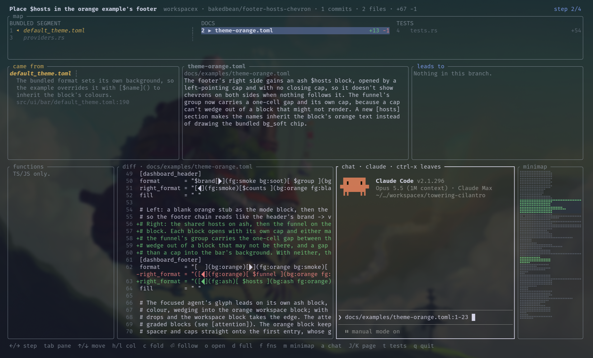

# codemapx

Code review in the age of agentic development can be challenging and time consuming. An agent can touch dozens of files in one session, and the diff shows them alphabetically, with none of the reasoning that connected them. codemapx tells the story of the changes in a pull request. It does this by:

- **Having the agent explain its own work.** The agent that wrote the branch knows why each edit was needed, so it writes the map: a short note on what changed in each file and why, and a one-line reason for each link between files. codemapx supplies the facts (files, diffs, line numbers, candidate links from imports) and validates the agent's annotations against them, so the story can't drift from the code.
- **Laying the changes out cause → effect.** Files are grouped into columns, from shared contracts on the left to the code that uses them, then entry points, then tests and docs. Links show which edit made the next one necessary.
- **Giving you a reading order.** A numbered trail walks you through every changed file, starting where the story starts, with the full diff of each file beside it.
- **Showing what isn't in the diff.** Unchanged files that shaped the edits appear as context cards, each with a quoted line as evidence, and anything the branch references but nobody built yet is flagged as missing.
- **Working on other people's PRs too.** Pointed at a pull request, the agent works out the reasons from the PR description, commits and code, and says plainly where an edit isn't explained. Those gaps are often what a reviewer most needs to ask about.

You can explore the map in a TUI, with an agent chat beside the diff for follow-up questions, or share it as a self-contained HTML page.

A navigable map of the code changes an agent made on a branch: which files changed, which edit made the next one necessary, and why. Built for catching up on a branch before review, not for watching edits stream in.



## Install

```sh
cargo install --path .
ln -s "$PWD/skill/codemapx" ~/.claude/skills/codemapx
```

`cargo install` puts the binary in `~/.cargo/bin`, so that directory must be on your `$PATH`. If `codemapx` isn't found, add `export PATH="$HOME/.cargo/bin:$PATH"` to your shell profile.

## Use

1. When an agent finishes a branch, run `/codemapx` in its session. It runs `codemapx collect`, writes the annotations and validates them.
2. Run `codemapx` in the worktree to open the map. Use `codemapx html -o map.html` to get a page you can share.

To review someone else's pull request, run `/codemapx <pr number or url>` in a fresh workspace. The skill resets the worktree's current branch to the PR's head (whatever the branch is called; it never creates or renames one), maps it against the PR's base, and says where the PR doesn't explain an edit. Run it again to pick up new pushes. It asks first if the reset would discard commits on the branch.

| Command | Does |
|---|---|
| `codemapx collect [--base REF]` | writes facts.json for the branch and prints the map dir |
| `codemapx validate` | checks annotations.json against facts.json |
| `codemapx` / `codemapx view` | opens the TUI |
| `codemapx html -o FILE` | writes a self-contained HTML page |

Maps live in `~/.local/state/codemapx/<repo>/<branch>/<head-sha>/`; set `CODEMAPX_STATE_DIR` to move them. Renaming the branch with `git branch -m` keeps its maps: lookups follow the renames recorded in the branch's reflog, taking only maps saved under an old name before the rename. Once that reflog expires, or if the branch is deleted and recreated, maps under its old names are no longer found.

## Keys

| Key | Action |
|---|---|
| `←` `→` | step through the edits in reading order (the numbers beside the map's cards; amber `◂` cards feed the selected one, blue `▸` cards follow from it) |
| `tab` | move between panes |
| `↑` `↓` | move within the focused pane (in the map, within the current column) |
| `h` `l` | map pane: move to the next column left or right (reaches context cards, which are off the trail) |
| `⏎` | in a came-from / leads-to pane, jump to that card; in the inside or functions pane, focus the diff |
| `o` | open the editor at the diff line, outline entry, function, or link evidence |
| `d` | full-screen diff (the diff pane always shows the whole file, with the changes in place) |
| `m` | show or hide the minimap right of the diff: the whole file shrunk to fit, added lines green, deleted lines red, the visible part shaded; click it to jump there |
| `f` | show or hide the functions panel left of the diff: a TS/JS file's top-level functions (including consts holding one), classes and their methods, `+` on those this branch added or deleted lines inside; moving in it jumps the diff to that function |
| `a` | show or hide the agent chat between the diff and the minimap: claude (or codex) running in its own TUI, read-only (claude runs with `--permission-mode default`, so anything beyond reading files, git included, prompts in the panel), briefed on the branch's map; focusing it queues a `path:start-end` reference for the lines you were on, typed once the composer is up and held while you stay in the chat; coming back from somewhere else swaps it for the new one, unless you have typed after it |
| `ctrl-x` | in the chat, return focus to the diff; while the agent runs every other key goes to it (except `ctrl-d` and `ctrl-z`, swallowed so a slip can't end or suspend it), and after it exits ⏎ restarts it |
| `J` `K` | page the diff |
| `t` | expand the Tests/Docs columns, which start collapsed (in narrow terminals this collapses the others) |
| `c` | collapse or expand the column holding the selected card |
| `C` | reset every column to the automatic layout |
| `q` / `esc` | quit (`esc` first closes the full-screen diff) |
| mouse click | focus the pane under the pointer and select the map card, link, outline entry or function there, as `tab` and ↑/↓ would (⏎ then follows a link) |
| mouse drag | drag the border between two rows, or between the diff and the functions panel, chat or minimap, to resize them |
| mouse wheel | move the pane under the pointer: scroll the diff (also over the minimap), or ↑/↓ in the map and middle panes (focus stays put); over the chat it goes to the agent if it asked for mouse input, else scrolls the chat's scrollback |

`o` runs `$EDITOR +<line> <path>` (default `nvim`). For editors that take another form, set a template, e.g. `CODEMAPX_EDITOR='code -g {path}:{line}'`.

The chat runs `claude` by default; `CODEMAPX_AGENT=codex` runs codex instead, and `CODEMAPX_AGENT_BIN` points at another binary. The agent starts the first time you press `a` and lives until codemapx quits. codemapx doesn't save or resume chats; the agent's own history settings still apply (claude, for one, keeps its transcripts as usual).

In a wsx workspace, the chat can hand a change to the workspace's primary agent: say "hand that to the workspace agent" and it runs `wsx agent send --workspace <repo>/<slug> primary "..."` with a self-contained instruction. claude may run that one command without a prompt; codex asks first. The send is fire-and-forget: check the workspace for the edit and re-run `/codemapx` to see it. codemapx looks for the workspace with `wsx workspace list --json` when the agent starts. Without wsx, or outside a workspace, the chat is unchanged.

The TUI captures the mouse for border drags and wheel scrolling; most terminals still select text with shift-drag (option-drag in iTerm2 and Terminal.app).

The map wants about 170 columns. Below that, Tests and Docs collapse to counts; below 130 the functions panel hides; below 100 it asks for a wider terminal.

## Development

`cargo test` runs against a synthetic TS repo built from `tests/sample/`. Goldens (`tests/sample/expected-facts.json`, `tests/golden/*.txt`) are refreshed with `UPDATE_GOLDEN=1 cargo test`; review the diff before committing.

`fixtures/` is local only and gitignored: pilot maps built from private branches. Never commit it.

See [docs/design-notes.md](docs/design-notes.md) for the pilot and [docs/superpowers/specs/2026-10-01-codemapx-v1-design.md](docs/superpowers/specs/2026-10-01-codemapx-v1-design.md) for the v1 design.
